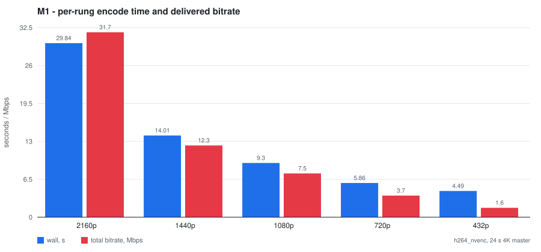
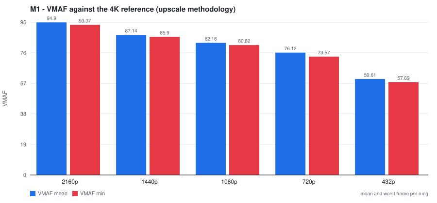
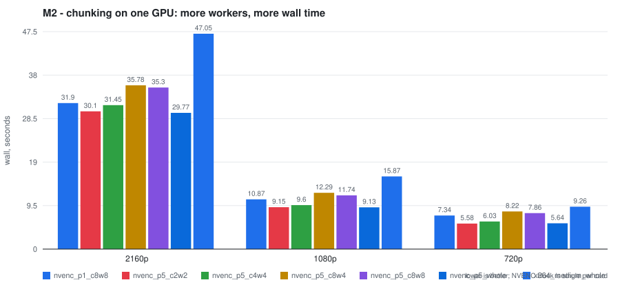
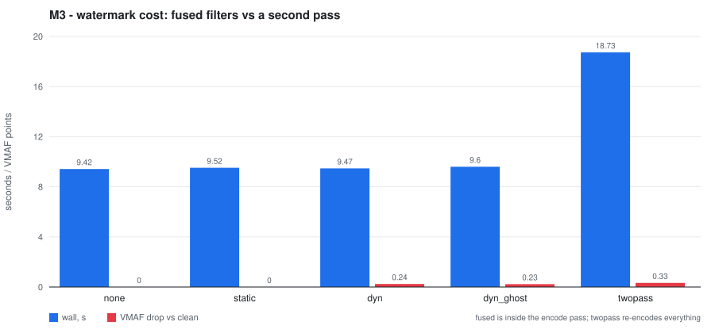

# vodpipe

A VOD transcoding pipeline built around FFmpeg and NVENC: ladder encoding, CMAF
packaging (HLS + DASH) from one pass, watermarking, VMAF quality measurement, and
a job queue with cooperative cancellation.

Everything in the Results section is measured on real hardware and committed as a
machine-readable artifact under [`bench/`](bench). There are no estimates here.

```
4K master -> probe -> ladder (5 rungs, NVENC) -> concat + integrity check
                  -> CMAF packaging (HLS + DASH) -> VMAF / bitrate -> report
                                     ^
                       FastAPI + Celery + RabbitMQ/Redis
```

## Why this repo exists

I come from frontend/Angular and wanted a video-processing role, so instead of
claiming experience I built the thing and measured it. The interesting part is
not that it works - it is what the measurements said, because three of the four
answers contradicted what I had read on the internet:

| Claim often repeated | What I measured (RTX 3060, ffmpeg 7.1) |
|---|---|
| NVENC is ~10x faster than x264 | **1.3-1.7x** on these rungs. At 2160p NVENC is only 0.82x realtime |
| Split the file, encode in parallel, get a speedup | On one GPU it is **strictly worse**: 2160p 29.8 s whole, 35.3 s at 8x8 |
| Watermarking costs CPU time you should budget for | Fused into the encode pass it is **free**: every variant lands inside the baseline's own 2.9% run-to-run spread. A separate pass costs **+103.9%** |

The reason parallel chunking fails is that the NVENC block is a fixed unit on the
card: one 4K encode already saturates it, so N processes only add contention plus
concat cost. Chunking earns its keep in the other direction - it bounds memory
and lets a job be resumed per chunk - and that is how the code uses it.

## Quickstart

No Docker and no GPU needed for the first three commands.

```bash
./scripts/bootstrap.sh          # venv, package, ffmpeg check, doctor, master
.venv/bin/python -m vodpipe demo
```

Windows: `scripts\bootstrap.ps1`, then `.venv\Scripts\python -m vodpipe demo`.
With `make`: `make doctor master demo`.

`vodpipe` needs ffmpeg on `PATH`, or `ffmpeg.exe`/`ffprobe.exe` in [`bin/`](bin),
or `VODPIPE_FFMPEG` pointing at it. It never downloads a binary silently.

The source clip is **generated**, not downloaded (`vodpipe master`): a
deterministic 4K lavfi composite (seed 42, 2-second GOP). Public sample mirrors
are unreachable from several networks and carry licensing questions, so the
pipeline is reproducible from an empty checkout instead. VMAF on synthetic
content is not the same as on a film master; the ratios carry, the absolutes
belong to this source.

## Commands

| Command | What it does |
|---|---|
| `vodpipe doctor` | which ffmpeg, encoders, filters and GPUs this machine really has |
| `vodpipe master` | generate the deterministic 4K source clip |
| `vodpipe demo` | full pipeline on a chosen ladder, writes `bench/demo.json` |
| `vodpipe bench` | encoder/parallelism matrix (M2) |
| `vodpipe watermark` | watermark overhead matrix (M3) |
| `vodpipe figures` | SVG charts from `bench/*.json` into `docs/figures/` |
| `vodpipe job` | submit / poll / cancel against a running API |

Every command is a thin wrapper over the library: the same calls are available to
the queue worker, the tests and a notebook without going through argparse.

## Results

### M1 - ladder of 5 rungs from a 24 s 4K master

`h264_nvenc`, whole-file encode, wall time per rung; bitrate read back out of the
HLS master playlist (BANDWIDTH is audio+video, which is what a player sees):

| Rung | wall, s | speed | delivered bitrate | VMAF mean | VMAF min |
|---|---|---|---|---|---|
| 2160p | 29.7 | 0.82x | 31 656 kbps | 94.90 | 93.37 |
| 1440p | 13.8 | 1.79x | 12 319 kbps | 87.14 | 85.90 |
| 1080p | 9.3 | 2.71x | 7 485 kbps | 82.16 | 80.82 |
| 720p | 5.8 | 4.48x | 3 680 kbps | 76.12 | 73.57 |
| 432p | 4.8 | 5.47x | 1 625 kbps | 59.61 | 57.69 |

Ladder wall time: **63.4 s** for five rungs, VMAF from 94.90 down to 59.61.
Artifact: [`bench/demo.json`](bench) (`vodpipe demo`, whole-file encoding).

The same ladder through the chunked path (8 chunks, 4 workers) is kept as
[`bench/m1_h264_nvenc_chunk8.json`](bench): **82.6 s** ladder wall. Chunking cost
~19 s here and added a concat step - the M2 result again, at ladder scale. VMAF
per rung is identical to within 0.05, as it should be: splitting the work must
not change what is encoded, only how it is split.




### M2 - encoder and parallelism matrix

Wall time per rung (lower is better). x264 at `medium`, NVENC whole-file, then
chunked with 2x2 / 4x4 / 8x8 workers:

| Rung | x264 medium | NVENC whole | 2x2 | 4x4 | 8x8 |
|---|---|---|---|---|---|
| 2160p | 47.1 s (0.52x) | **29.8 s (0.82x)** | 30.1 | 31.5 | 35.3 |
| 1080p | 15.9 s (1.54x) | **9.1 s (2.75x)** | 9.2 | 9.6 | 11.7 |
| 720p | 9.3 s (2.66x) | **5.6 s (4.58x)** | 5.6 | 6.0 | 7.9 |

Chunking never wins on one card, at any rung. The per-process throughput does go
up, which is why a benchmark that reports only "speed" would have called it a
win: the code reports `wall_s` and `agg_speed_x` separately, because wall time is
what a user waits for.

Artifact: [`bench/m2_bench.json`](bench).



### M3 - watermark cost

Same rung (1080p), same encoder, each variant repeated twice:

| Mode | wall, s | overhead | VMAF mean | VMAF min | kbps |
|---|---|---|---|---|---|
| none (baseline) | 9.23 | - | 82.16 | 80.82 | 6909 |
| static corner logo | 9.16 | **-0.8%** | 82.17 | 80.98 | 6916 |
| drifting per-viewer id | 9.13 | **-1.1%** | 81.92 | 80.57 | 6949 |
| + near-invisible second layer | 9.07 | **-1.7%** | 81.93 | 80.41 | 6922 |
| separate watermark pass | 18.82 | **+103.9%** | 81.85 | 80.76 | 7080 |

The baseline itself measured 9.37 s and 9.10 s across two runs - a 2.9% spread -
so every variant is repeated and averaged, and every fused variant lands inside
that spread. The negative overheads are that noise, not a speedup: a fused
watermark is not measurably slower than no watermark. Fused filters ride the
decode the encode already performs. A second pass decodes and re-encodes the
whole asset, so it doubles the cost, and it adds a generation of quality loss
(VMAF -0.31 against the source, on top of what the first pass already took).

The dynamic mark drifts in position and alpha as a function of `t`, so there is
no fixed pixel region to crop or box-blur out; the ghost layer runs at a
different phase, so cropping one mark still leaves the other in another frame
range. This is session identification, not a forensic watermark: it does not
survive a re-encode of the picture. Forensic marking needs a robust payload
spread across frames (DCT-band coefficients), which I have not built.

Artifact: [`bench/m3_watermark.json`](bench).



### M4 - queue, progress, cancellation

Submit a 3-rung ladder and cancel it at `encode 1/3`:

```
$ vodpipe job --source src_clip/4k_master.mp4 --rungs 2160p,1440p,1080p --cancel-at 1/3
job: b3978ecc0e91
  PENDING p=0.0: queued
  RUNNING p=0.01: gpu-probe
  RUNNING p=0.21: encode 1/3
  -> cancel at encode 1/3
  CANCELLED p=1.0: cancelled
```

Result: status `CANCELLED`, the rungs finished before the cancel (`2160p`,
`1080p`) kept with their measured bitrates (29 123 and 6 772 kbps), the third
rung marked `cancelled`, ladder wall 39.19 s, report preserved. A cancelled job
is not a failed job: its finished output is still usable. Artifact:
[`bench/m4_cancelled_report.json`](bench).

Two things had to be understood rather than guessed:

* **Celery's `revoke()` is wrong here.** It marks the task `REVOKED` *and wipes
  the stored result*, which throws away the rungs that finished successfully.
  Cancellation is instead a Redis flag checked between rungs, and a TTL so a
  stale flag can never cancel a later job.
* **Progress must be per rung, not per phase.** A five-rung ladder takes
  minutes; reporting only between phases means the client stares at one number
  the whole time. `on_rung_done` fires after every rung.

## Design

**Pure core, imperative shell.** Every stage is split into a function that builds
the argv (no process, no GPU, unit-testable) and a runner that executes it:
`whole_args()` / `transcode_whole()`, `hls_args()` / `package_hls()`,
`vmaf_args()` / `vmaf()`. `ff.Runner(execute=..., timeout_s=..., env=...)` is the
only place a subprocess is created: tests substitute a fake `execute` that records
argv without running anything, and a bounded probe passes its own `timeout_s`.

That split is what makes the suite runnable on a GPU-less CI runner: the parts
that decide *what* to run are tested directly, the parts that run them carry the
`ffmpeg` / `gpu` markers and skip. The one exception is deliberate - a single
`ffmpeg`-marked test feeds a filtergraph-injection payload to the real binary,
because a unit test cannot prove that ffmpeg's *parser* agrees with our escaping,
and that assumption is exactly what used to be wrong.

| Module | Responsibility |
|---|---|
| `ff.py` | binary discovery, the one `Runner`, ffmpeg output parsers |
| `probe.py` | source metadata, `plan_chunks` (chunk boundaries on IDR frames only) |
| `ladder.py` | rung definition and the invariants a ladder must satisfy |
| `encoders.py` | per-encoder argv, option spellings resolved at runtime |
| `encode.py` | whole-file and chunked encode, parallel workers |
| `ts.py` | concat, and the packet-count integrity proof |
| `packager.py` | CMAF HLS + DASH in one pass, manifest parsing |
| `metrics.py` | VMAF (upscale methodology), measured bitrate |
| `watermark.py` | filter fragments and the escaping they need |
| `gpu.py` | card discovery and an actual NVENC probe per card |
| `pipeline.py` | orchestration, progress and cancellation hooks |
| `jobs.py` | queue state semantics, stdlib only |
| `mediarange.py` | RFC 7233 ranges and media MIME types |
| `server/` | FastAPI intake, Celery worker, byte-range delivery |

Five decisions I would defend in a review:

1. **Every rung is exactly 16:9 with dimensions divisible by 8.** The textbook
   "480p = 854x480" has DAR 427:240, and the DASH muxer then refuses the whole
   manifest ("Conflicting stream aspect ratios values in AdaptationSet"). The
   ladder uses 432p (768x432) instead. `ladder.validate()` rejects it up front.
2. **Chunk boundaries are IDR frames only.** Cutting mid-GOP produces a chunk
   whose first frame references frames that do not exist. `plan_chunks()` chooses
   from the keyframe list, and a test asserts contiguity and exact coverage.
3. **Container duration is not trusted on concatenated TS.** Each chunk carries
   its own PCR, so ffprobe reports a duration that lies. Integrity is proven by
   counting video packets against the expected frame count (`ts.verify_concat`).
4. **GPU index is never hardcoded.** The order changes with the hardware
   configuration - a hardcoded index 0 pointed at a datacenter card whose NVENC
   cannot even initialize. `gpu.pick()` ranks cards and then *probes* each with
   one second of real encoding, caching only successes.
5. **Option spellings are read, not guessed.** One build accepts `-spatial_aq`,
   another `-spatial-aq`; guessing wrong does not degrade quietly, it exits with
   "Unrecognized option". `ff.pick_option()` reads `ffmpeg -h encoder=<codec>`.

Bugs the tests caught, worth naming because they were silent:

* the HLS parser matched `BANDWIDTH=` and hit `AVERAGE-BANDWIDTH=` first, which
  ffmpeg emits *before* BANDWIDTH - every rung reported the wrong bitrate;
* a `-filters` regex assumed a 6-char flag column; ffmpeg 7.x prints 3, so every
  capability check silently returned "not available";
* `expected_video_frames` was called through the wrong module, raising
  `AttributeError` on the live path after every ladder.

## Quality measurement

VMAF compares the **distorted rendition upscaled to the reference size** against
the full reference. Comparing a 1080p rung against a 1080p slice of the source
measures mostly the scaler. `n_threads=8` matters as much: libvmaf defaults to
one thread (~1.8 fps on 4K), and with 8 threads it ran at ~13.7 fps. A metric
slower than the encode is a metric nobody runs on a catalogue.

Harmonic mean is the number quoted for a ladder because it punishes the bad
frames instead of averaging them away, and `vmaf_min` is reported per rung - the
mean hides exactly the frames that make a viewer quit.

## API

| Method | Purpose |
|---|---|
| `GET /health` | probes broker, result backend and queue depth separately |
| `POST /jobs` | 202 + `job_id`; source must live inside the media root |
| `GET /jobs/{id}` | state, progress, per-rung rows, artifacts |
| `POST /jobs/{id}/cancel` | cooperative cancel at the next rung boundary |
| `GET /jobs/{id}/report` | the run's JSON report |
| `GET /media/{job}/{path}` | manifests and segments, byte-range support |

Queue depth is read with `queue_declare` straight from AMQP - declaring is
idempotent, so this needs no management API and no extra credentials.

Running it:

```bash
docker compose up -d rabbitmq redis       # infrastructure
python -m vodpipe.server.tasks            # worker on the host
python -m vodpipe.server.main             # API
```

On this machine the worker runs on the host because Docker Desktop cannot pass a
GPU into its WSL2 VM (`cuInit` -> `CUDA_ERROR_NO_DEVICE`). On a Linux server the
same image covers the worker: `docker compose --profile gpu up worker`. Celery on
Windows needs `-P threads` (no fork); concurrency is 1 either way, since one NVENC
session already saturates a card.

## Tests, lint, CI

```bash
pytest -q                 # 171 tests; ffmpeg/gpu marked tests skip without hardware
ruff check src tests
mypy
```

CI ([`.github/workflows/ci.yml`](.github/workflows/ci.yml)) runs ruff and pytest on
Python 3.10 and 3.12 with ffmpeg installed and no GPU, which is exactly the split
the design is built around.

The tests concentrate on the parts that are invisible at a glance: argv
construction, ffmpeg's text output parsing, range handling, ladder invariants,
job state mapping, and the escaping rules that decide whether a filtergraph
parses at all.

## Honest limitations

* One RTX 3060. No multi-GPU measurement, and the chunking conclusion is only
  about a single card - across cards the picture is different.
* The source is synthetic. VMAF absolutes belong to it; ratios and the
  encoder/parallelism conclusions transfer, absolute quality numbers do not.
* Watermarking is session identification, not forensic marking.
* `hevc_nvenc` and `h264_qsv` are wired and verified to exist; only the h264 path
  was benchmarked end to end.
* No content-protection stack (no DRM, no AES-128 sample-AES in the manifests).
* The queue is proven on one host with one worker. No autoscaling, no sharding.

## License

MIT - see [LICENSE](LICENSE). Changes: [CHANGELOG.md](CHANGELOG.md).
